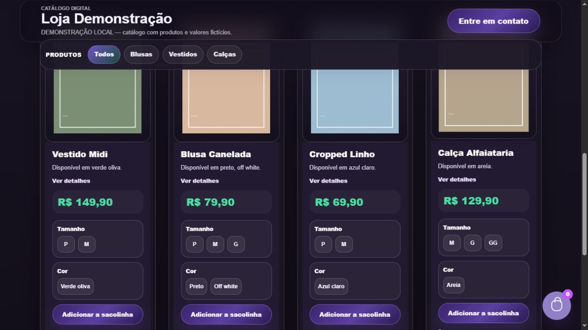
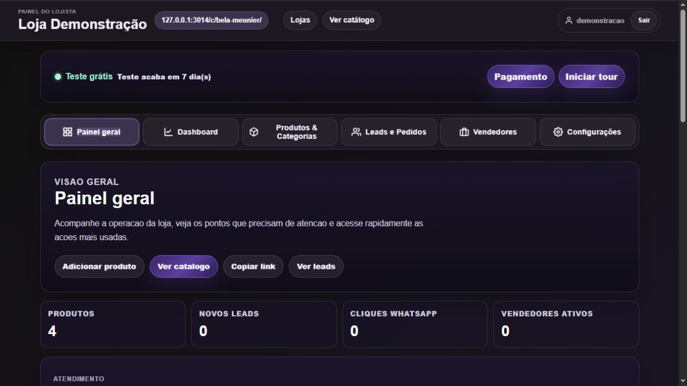

<p align="center"></p>

# VestLink

Catálogos digitais para lojas de roupas, com painel do lojista, produtos e contato pelo WhatsApp.

**Python · Django · Supabase**

[**📚 Instalação e configuração**](docs/guia-configuracao.md) · [Código](https://github.com/igorcastro1010/vestlink) · [Mais projetos](https://github.com/igorcastro1010)

> Demonstração temporariamente indisponível: [vestlink.vercel.app](https://vestlink.vercel.app) retornou erro 500 na verificação de 22/10/2026. As capturas abaixo foram produzidas localmente e não comprovam a recuperação do site público.

## Funcionalidades em tela

Capturas de demonstração local com dados fictícios, preparadas em 22/10/2026. Não representam dados de produção. [Como foram produzidas](docs/capturas-demonstracao.md).

### Catálogo de produtos



As imagens dos produtos são os marcadores ilustrativos do seed de demonstração do projeto.

### Painel do lojista



## Funcionalidades

- Catálogo com fotos, tamanhos, cores e variações.
- Painel para gerenciar lojas e produtos.
- Leads e venda pelo WhatsApp.
- Configuração de autenticação e banco no Supabase.

## Começar

```powershell
python -m pip install -r requirements.txt
python manage.py migrate
python manage.py seed_demo
python manage.py runserver
```

Use um ambiente local de desenvolvimento. Confira as configurações de banco antes de executar migrações.

## Documentação técnica

O [guia de configuração](docs/guia-configuracao.md) preserva as instruções anteriores de instalação, variáveis de ambiente, banco e publicação. A página inicial do repositório concentra a apresentação do produto.
